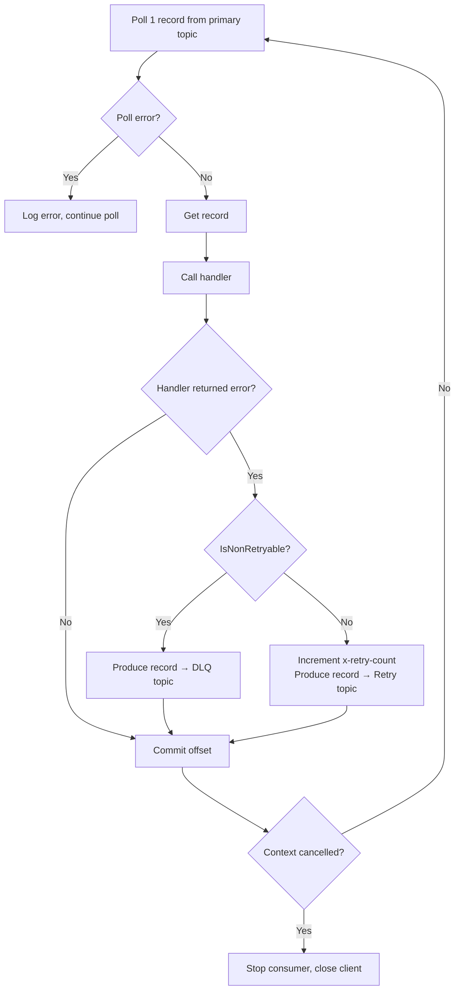
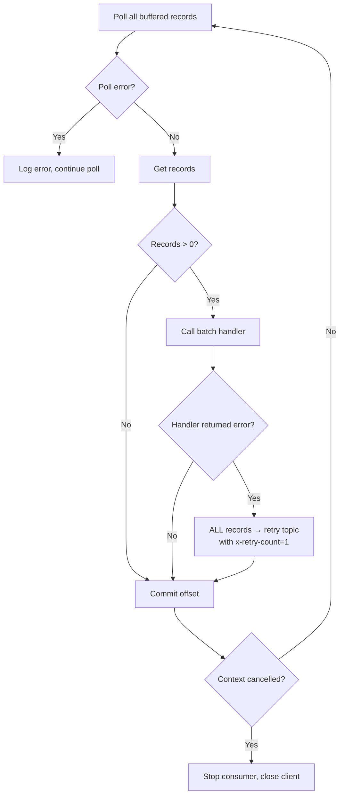
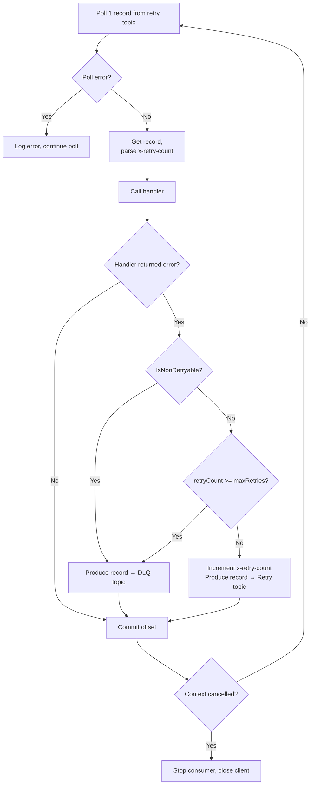
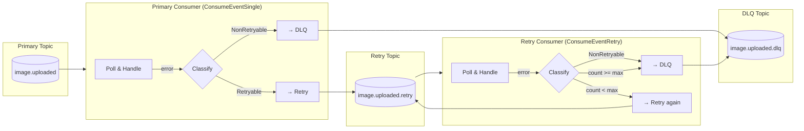
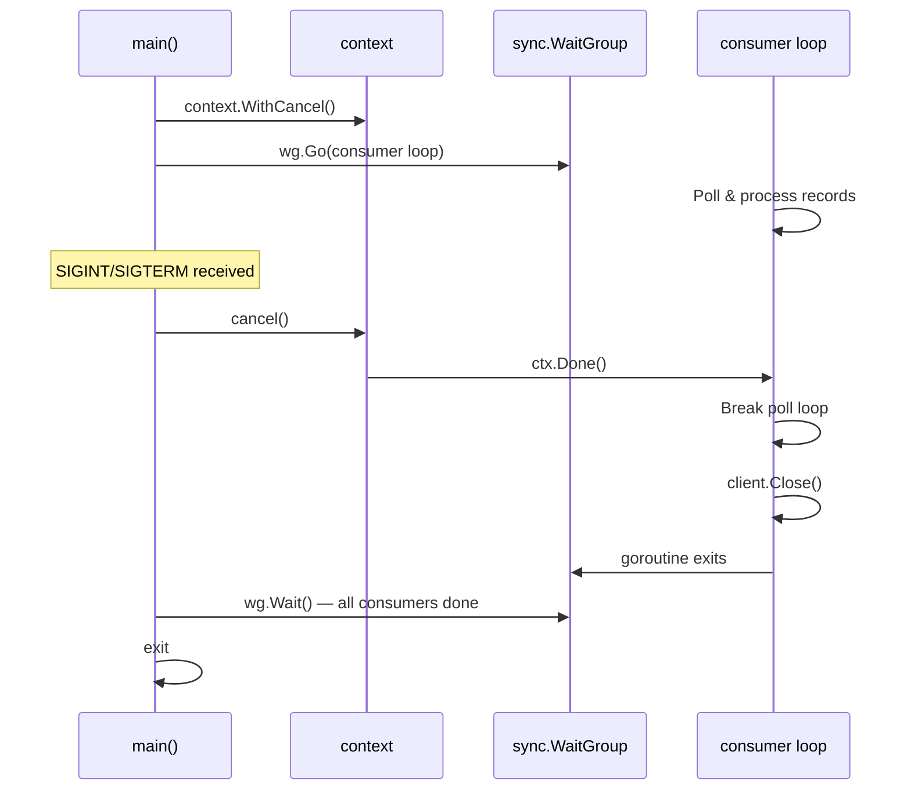

# Kafka Consumer Error Handling

## Topic Topology

Every primary topic has a corresponding **retry** and **DLQ** topic, mapped in `pkg/constant/topic/topic.go`.

| Primary | Retry | DLQ |
|---------|-------|-----|
| `image.uploaded` | `image.uploaded.retry` | `image.uploaded.dlq` |
| `image.liked` | `image.liked.retry` | `image.liked.dlq` |
| `image.commented` | `image.commented.retry` | `image.commented.dlq` |
| `user.followed` | `user.followed.retry` | `user.followed.dlq` |
| `notif` | `notif.retry` | `notif.dlq` |

A `x-retry-count` header tracks retry attempts (stored on the record, incremented each hop). Max retries configured via `kafka.consumer.max_retries`.

## Consumer Loop Types

Three loop patterns in `internal/inbound/messaging/consumer.go`:

| Function | Poll Mode | Record Count | Error Routing |
|----------|-----------|-------------|---------------|
| `ConsumeEventSingle` | Poll 1 record | 1 | DLQ if `IsNonRetryable`, else retry |
| `ConsumeEventBatch` | Poll all buffered | N | All → retry (with count=1) |
| `ConsumeEventRetry` | Poll 1 record | 1 | DLQ if exhausted or non-retryable, else retry |

## Error Classification — `pkg/errkit/nonretryable.go`

Consumer handlers wrap **JSON unmarshal failures** with `WrapNonRetryable` — these are structural errors that will never succeed on retry. Business logic errors (from usecases) are returned as-is, so they are retryable.

| Error Source | Wrapped? | Classification |
|-------------|----------|---------------|
| `json.Unmarshal` failure | `WrapNonRetryable` | Non-retryable → DLQ |
| Usecase returns error | No wrapper | Retryable → retry topic |

## Flow Diagrams

### Single Consumer (`ConsumeEventSingle`)

### Batch Consumer (`ConsumeEventBatch`)

> **Note**: Batch consumers currently send *all* records in the batch to retry even if only one failed. A TODO in the code acknowledges this should be per-record granularity.

### Retry Consumer (`ConsumeEventRetry`)

### Full End-to-End Error Flow

## Graceful Shutdown

Key points:
- `cmd/workerconsumer/main.go` sets up a shared `context.WithCancel` and `sync.WaitGroup`.
- All consumer goroutines are started via `wg.Go` (syntactic sugar for `go func()` + `wg.Add`/`wg.Done`).
- Each consumer loop checks `ctx.Err()` after every poll-commit cycle.
- On OS signal, `cancel()` triggers `ctx.Done()` which causes all loops to exit, then `wg.Wait()` blocks until all consumers finish their current processing.