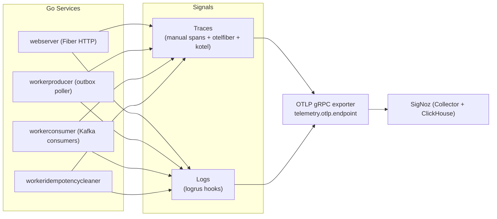
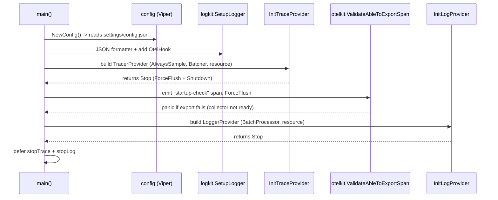
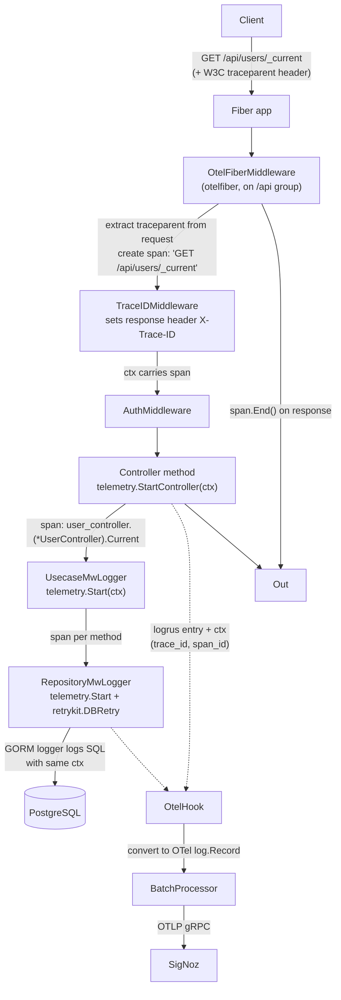
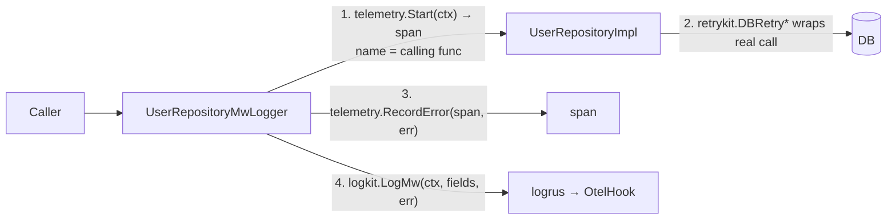
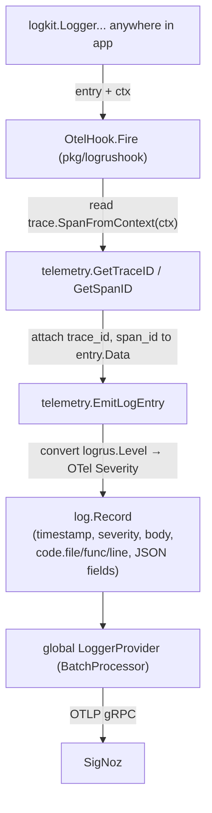
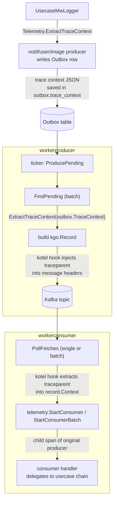
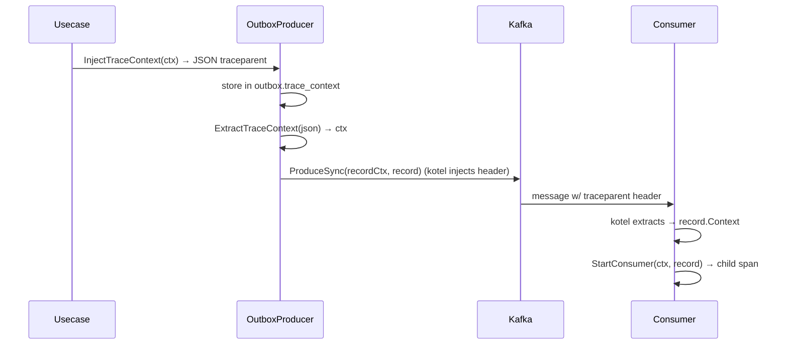
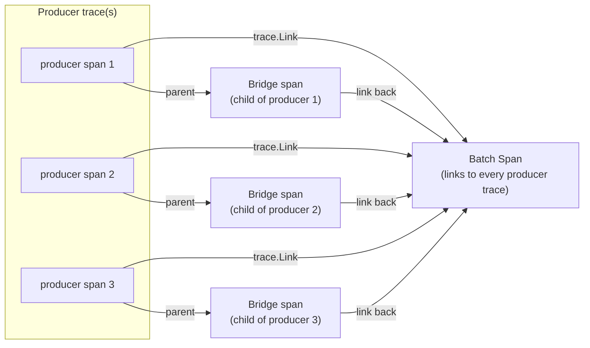

# OpenTelemetry (OTel) Architecture

How this project implements OTel: **traces** (manual spans + auto-instrumentation) and **logs** (logrus → OTLP logs), both shipped over **OTLP gRPC** to SigNoz (ClickHouse-backed). No metrics signal.

Key packages:

| Piece | Location |
|---|---|
| Trace provider / log provider | `pkg/telemetry/otel_trace_provider.go`, `pkg/telemetry/otel_log_provider.go` |
| Span helpers | `pkg/telemetry/otel_start.go`, `pkg/telemetry/record_error.go` |
| Trace↔log correlation | `pkg/logrushook/otel_hook.go`, `pkg/telemetry/otel_emit_log.go` |
| Outbox trace persistence | `pkg/telemetry/outbox.go` |
| Startup sanity check | `pkg/otelkit/otelkit.go` |
| HTTP middleware | `internal/inbound/http/middleware/otel_fiber_middleware.go`, `trace_id_middleware.go` |
| Kafka instrumentation | `internal/provider/kafka_provider.go` (kotel) |
| Span-per-method decorator | `*_mw_logger.go` files |

---

## 1. Big picture



- **Traces** come from two sources: *manual spans* (`telemetry.Start`) and *auto-instrumentation* (otelfiber for HTTP, kotel hooks for Kafka).
- **Logs** are logrus entries converted to OTel log records by a hook.

---

## 2. Process boot sequence (every binary)

Every `cmd/*/main.go` follows the same telemetry boot order:



Boot code (`cmd/webserver/main.go:48-54`):

```go
stopTraceProvider := telemetry.InitTraceProvider(cfg)
defer stopTraceProvider()

otelkit.ValidateAbleToExportSpan()   // fail fast if collector is down

stopLogProvider := telemetry.InitLogProvider(cfg)
defer stopLogProvider()
```

**Provider details** (`pkg/telemetry/otel_trace_provider.go`):

- `sdktrace.NewTracerProvider` with `AlwaysSample`, batch exporter, resource carrying `service.name` = `app.name` from config.
- Sets the **global propagator**: `TraceContext` (W3C `traceparent`) + `Baggage` → `otel.SetTextMapPropagator`.
- Exporter: `otlptracegrpc` with `WithInsecure()` to `telemetry.otlp.endpoint`.
- `otelkit.ValidateAbleToExportSpan()` sends a throwaway span and `ForceFlush`es with a 5s timeout — a hard startup gate on collector availability.

The log provider mirrors this with `sdklog.NewLoggerProvider` + `NewBatchProcessor`.

**`workeridempotencycleaner`** (`cmd/workeridempotencycleaner/main.go`) follows the same boot order (trace provider → log provider, both deferred) and **does emit traces** — not from `runCleaner` itself, but through the decorator chain: each `DeleteOlderThan` call goes via `IdempotencyUsecaseMwLogger` → `telemetry.Start`, producing a **root span** (no parent trace, since the ticker has no incoming context). So the Cleaner appears under both `Traces` and `Logs` in the §1 diagram.

---

## 3. HTTP request trace flow (webserver)



Route wiring (`internal/inbound/http/route/route_http.go:16`):

```go
api := root.Group("/api", middlewares.OtelFiberMiddleware, middlewares.TraceIDMiddleware)
```

1. **OtelFiberMiddleware** (`gofiber/contrib/otelfiber`) auto-instruments inbound HTTP: extracts the parent context from `traceparent`, creates a span named `"METHOD /path"` (custom `WithSpanNameFormatter`), and ends it when the response finishes.
2. **TraceIDMiddleware** reads `telemetry.GetTraceID(ctx)` and echoes it as the `X-Trace-ID` response header for the caller.
3. Each **controller** starts a function-named span via `telemetry.StartController(ctx)` (`pkg/telemetry/otel_start.go:12`) which seeds `ctx.UserContext()` so everything downstream inherits the trace.

---

## 4. Decorator pattern — a span per method

Every usecase and outbound interface is wrapped by an `*_mw_logger.go` decorator that is the **single place** where spans, error recording, and logs happen:



For the make-or-break rule (every outbound interface must have a decorator, and where to wire it) see **AGENTS.md → Decorator pattern**. This section documents only the telemetry mechanics inside every generated method (see e.g. `internal/outbound/repository/user_repository_mw_logger.go:26`):

```go
func (r *UserRepositoryMwLogger) Create(ctx context.Context, db *gorm.DB, user *entity.User) error {
    ctx, span := telemetry.Start(ctx)   // span named "repository.(*UserRepositoryMwLogger).Create"
    defer span.End()

    err := retrykit.DBRetry(ctx, func() error {
        return r.Next.Create(ctx, db, user)
    })
    telemetry.RecordError(span, err)    // span.RecordError + set status=ERROR
    logkit.LogMw(ctx, fields, err)      // Debug on success, Error on failure
    return err
}
```

- Four steps, always in this order: **start span → call real method (wrapped in retry) → record error → emit log**.
- `telemetry.Start` derives the span name from the **caller's function name** via `pkg/caller` (`otel_start.go:80`) — so the function name *is* the span name.
- `retrykit.DBRetry(ctx, fn)` for no-value methods; `retrykit.DBRetryWithData(ctx, fn)` for value-returning ones (see `CountByUsername`).
- `logkit.LogMw(ctx, fields, err)` emits **Debug on success, Error on failure**; `fields` carries the call's inputs/outputs (e.g. `username`, `total`).
- The wrapper struct holds the real impl in a `Next` field, and `var _ Interface = &InterfaceMwLogger{}` asserts it still satisfies the interface.

---

## 5. Log correlation (logrus → OTLP logs)



`pkg/logrushook/otel_hook.go`:

- Runs on **every** logrus entry (`AllLevels`).
- Pulls `trace_id` / `span_id` from the context and injects them as log fields (this is what makes logs joinable to traces in SigNoz).
- Calls `telemetry.EmitLogEntry(entry)` (`pkg/telemetry/otel_emit_log.go`), which maps severity, sets the message as body, adds caller code location attributes (`semconv.CodeFunction/Filepath/LineNumber`), JSON-serializes all `entry.Data` fields, then `logger.Emit(ctx, record)`.

The hook is registered in `logkit.SetupLogger`:

```go
logger.SetReportCaller(true)
logger.SetLevel(lvl)
logger.SetFormatter(&logrus.JSONFormatter{})
logger.AddHook(logrushook.NewLevelColorHook())
logger.AddHook(logrushook.NewOtelHook())   // <-- telemetry bridge
```

Note: this also means **GORM SQL logs** (custom `gormLogger` in `internal/provider/gorm_provider.go`) carry the same `trace_id`/`span_id` because they log through `logkit.Logger.WithContext(ctx)`.

---

## 6. Kafka produce → consume flow

Kafka uses **kotel** (`github.com/twmb/franz-go/plugin/kotel`), a hook attached to the kgo client that auto-injects the `traceparent` into message headers on produce and auto-extracts it on consume.



**Producer side** (`internal/provider/kafka_provider.go`):

```go
tracer := kotel.NewTracer()
opts = append(opts, kgo.WithHooks(tracer))
```

**Outbox trace hand-off** — the outbox row stores the trace context as JSON so the *async* produce step can recreate it:

- Write (`internal/outbound/messaging/user_producer.go:60`): `TraceContext: telemetry.InjectTraceContext(ctx)` — serializes the active `traceparent`/`baggage` into a JSON string column.
- Read (`internal/outbound/messaging/outbox_producer.go:65`): `recordCtx := telemetry.ExtractTraceContext(ctx, outbox.TraceContext)` — rebuilds the span context before `ProduceSync`, so kotel embeds the **original** trace ID into the Kafka message headers.



**Consumer span strategies** (`pkg/telemetry/otel_start.go`):

- **Single** (`StartConsumer`): reads the producer span context from `record.Context` (put there by kotel), then starts a **child** span using the shutdown-aware `ctx` as base (so cancellation propagates).
- **Batch** (`StartConsumerBatch`) — the "Batch + Bridge" pattern:



- The **Batch Span** anchors the whole poll and `WithLinks` to every producer span.
- Each message gets a **Bridge Span** whose *parent is the original producer* (preserves lineage) and which adds a `trace.Link` back to the batch span — bi-directional correlation between a message's trace and the batch that processed it.

---

## 7. Configuration

Single source: `settings/config.json` → `internal/config/configkey.go:43`

```jsonc
{
  "app": { "name": "..." },
  "log": { "level": "info" },
  "telemetry": { "otlp": { "endpoint": "localhost:4317" } }
}
```

| Config key | Used for |
|---|---|
| `app.name` | `service.name` resource attribute on both providers |
| `log.level` | logrus level (before hook) |
| `telemetry.otlp.endpoint` | OTLP gRPC endpoint for traces **and** logs |
| `kafka.bootstrap.servers` | kotel-instrumented kgo clients |
| `outbox.*` | producer poll cadence / batch size |

---

## 8. Signal summary

| Signal | Source | Export path |
|---|---|---|
| Trace | `telemetry.Start*` (MwLogger decorators), otelfiber, kotel | Batch span exporter → OTLP gRPC |
| Log | logrus → `OtelHook` → `EmitLogEntry` | `sdklog` BatchProcessor → OTLP gRPC |
| Metric | — | not implemented |

For querying traces from SigNoz/ClickHouse, see the `signoz-traces` skill.